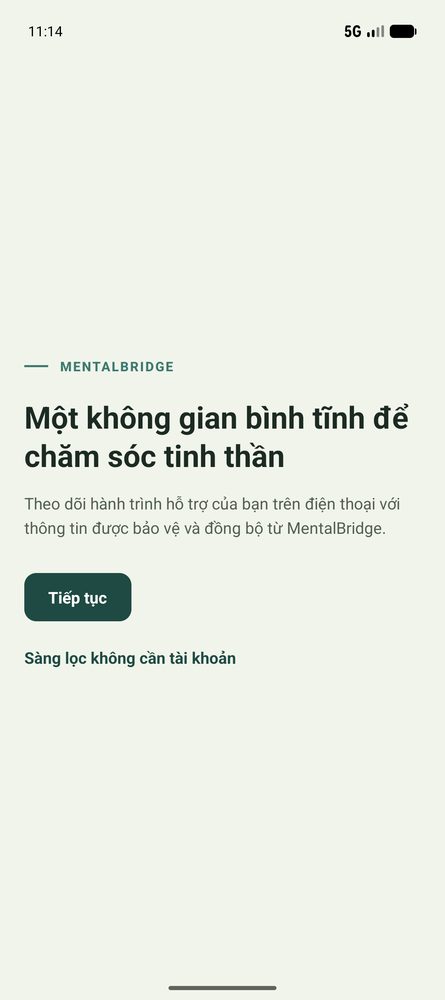
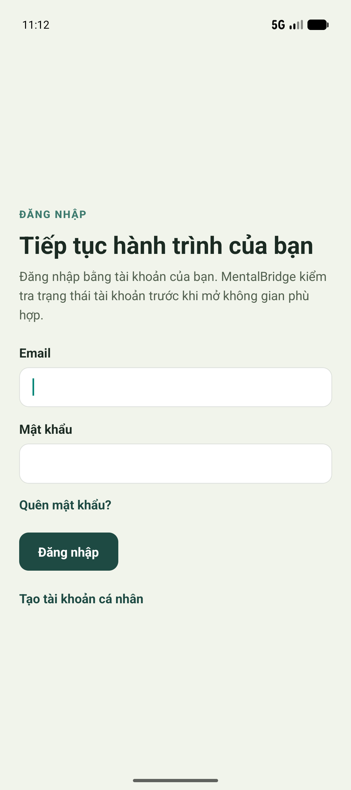

# MB-662 Android evidence

Captured on 2026-10-31 from the `Pixel_9_Pro_Fold` Android emulator after
building and installing the release APK for commit `012cd08f`.

## Native boot

## Navigation to sign-in

Runtime details are recorded in [`android-runtime.txt`](./android-runtime.txt).
The app remained in the foreground with its process alive, and the captured
log window contained no React Native runtime error or fatal app crash.

The generated APK remains in the ignored `native-evidence/` directory and is
not committed because it is a build artifact. CI is responsible for uploading
native build artifacts as documented in `docs/NATIVE_VERIFICATION.md`.
